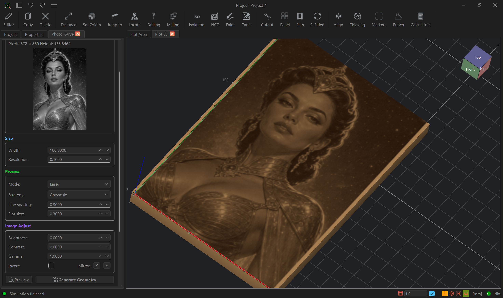

# FlatCAM Evo

[](LICENSE)


**FlatCAM Evo** is a free, open-source 2D CAM program for PCB manufacturing. It reads the files that a PCB design
program makes (Gerber, Excellon, ODB++ jobs, board files of Altium, KiCad, Eagle, OrCAD/Allegro, DipTrace, Proteus
and Sprint Layout) and makes the G-code that a CNC router, a CNC mill or a laser needs to make the board: isolation
routing, copper clearing, drilling, slot milling, board cutout, solder paste dispensing and more. It also carves and
laser-engraves photos (Photo Carve).

FlatCAM Evo continues [FlatCAM](http://flatcam.org) by Juan Pablo Caram. It has a modern PyQt6 interface, a fast
OpenGL canvas, many new plugins and a Tcl scripting shell for automation.

| | |
|---|---|
| **User manual** | [FlatCAM Evo wiki](https://github.com/MariusAdrian88/FlatCAM_Evo/wiki) |
| **Downloads** | [Releases](https://github.com/MariusAdrian88/FlatCAM_Evo/releases): Windows installer, Linux AppImage, macOS DMG |
| **Video tutorials** | [YouTube playlist](https://www.youtube.com/playlist?list=PLVvP2SYRpx-AQgNlfoxw93tXUXon7G94_) |
| **Changes** | [CHANGELOG.md](CHANGELOG.md) |
| **Stable code** | branch [`main`](https://github.com/MariusAdrian88/FlatCAM_Evo/tree/main) |
| **Development code** | branch [`1.0`](https://github.com/MariusAdrian88/FlatCAM_Evo/tree/1.0) |

---

## Contents

- [What FlatCAM Evo does](#what-flatcam-evo-does)
- [Main features](#main-features)
- [Screenshots](#screenshots)
- [Installation](#installation)
- [Quick start](#quick-start)
- [Documentation](#documentation)
- [For developers](#for-developers)
- [Reporting bugs and contributing](#reporting-bugs-and-contributing)
- [License and credits](#license-and-credits)

---

## What FlatCAM Evo does

1. **Load** the manufacturing files of the board: Gerber layers and Excellon drill files, a complete board file, an
   ODB++ job, or SVG, DXF, PDF, HPGL2, image and G-code files.
2. **Prepare** the objects: move, mirror, rotate, scale, panelize, join, or edit them in the built-in editors.
3. **Generate** the toolpaths with a plugin: isolation routing, copper clearing, drill and slot paths, board cutout,
   solder paste paths and more.
4. **Create a CNC job**, check it on the canvas, and save the G-code with the preprocessor of your machine.

The program keeps all objects of a job in 1 **project** file (`.FlatPrj`).

---

## Main features

- Native **Gerber** (RS-274X with X2/X3 attributes) and **Excellon** (with XNC) parsers.
- **Direct import of PCB board files**: Altium, CircuitStudio / CircuitMaker, KiCad, Eagle, OrCAD/Allegro, DipTrace,
  Proteus, Sprint Layout 6, PADS, EasyEDA Pro, IPC-2581 and ODB++.
- **G-code import** and transforms of CNC jobs that change the G-code text and the plot together.
- **Isolation routing**, **Non-copper clearing**, **Paint**, **Drilling**, **Milling**, **Cutout** and **Photo Carve**.
- **Double-sided boards**, **Panelization**, **Autolevelling** and **Compare** of 2 board revisions.
- **Board preparation**: copper thieving, fiducials, markers, QR codes, punched pads, etch compensation, film output
  with a preview, and a design rule check.
- **3 editors** (Gerber, Excellon, Geometry), a **code editor**, and **Undo / Redo** for each project.
- **Document objects**: **File > Open > Open Document** imports PDF, text files, HTML and legacy FlatCAM projects as Document objects. A PDF Document embeds the original PDF and opens in the PDF Viewer; text and HTML files open in the built-in text editor. Clicking a Document in the project tree opens or focuses its viewer. The project file saves the embedded content. A standalone Save exports a PDF Document to `.pdf`, plain text to `.txt` and formatted rich text to `.html`.
- **31 G-code preprocessors**, and you can add your own.
- **Export** to Gerber, Excellon, G-code, SVG, PNG, PDF, DXF and STEP.
- **Tcl shell** with script files, command-line options and a headless mode.
- **Tools Database**, updates from the program, light and dark themes, and 9 languages.

The [wiki](https://github.com/MariusAdrian88/FlatCAM_Evo/wiki) has a page for each feature.

In Film, the **Generate** button creates a persistent output: SVG makes a `_film` Geometry object, PDF makes a `_film` PDF Document. Both stay in the project after you close Film. Clicking **Generate** again in the same Film session updates the tracked output instead of making a new object. PNG remains a transient preview. **Save** reuses a valid artifact; if none exists or the settings changed, it generates first. In the PDF Viewer, **Ctrl+mouse wheel** zooms around the mouse pointer; the zoom percentage and slider stay synchronized.

---

## Screenshots

### Main Application


### PCB Preview


### PCB Isolation / Engraving


### PCB Non Copper Clearing


### PCB Paint a Gerber


### Photo Carve



---

## Installation

FlatCAM Evo runs on **Windows**, **Linux** and **macOS**. The
[Installation](https://github.com/MariusAdrian88/FlatCAM_Evo/wiki/Installation) page of the wiki has all the
details.

### Ready-to-run packages

Each [release](https://github.com/MariusAdrian88/FlatCAM_Evo/releases) has these packages. They need no Python:

| System | Package |
|---|---|
| Windows (64-bit) | `FlatCAM_Evo_<version>_win64.exe`: an installer |
| Linux (x86-64) | `FlatCAM_EVO-<tag>-linux-x86_64.AppImage`: make it executable (`chmod +x`), then start it |
| macOS (Apple silicon) | `FlatCAM_EVO-<tag>-macos-arm64.dmg`: drag the app into Applications |

The Linux AppImage needs **glibc 2.34 or newer** (for example Ubuntu 22.04, Debian 12 or AlmaLinux 9). Check with
`ldd --version`.

### From the source code

You need **Python 3.10 or newer** (64-bit) and a working **OpenGL** graphics driver.

```bash
git clone https://github.com/MariusAdrian88/FlatCAM_Evo.git
cd FlatCAM_Evo
```

With conda / mamba (recommended, all systems):

```bash
mamba env create -f environment.yml
mamba activate flatcam
python install_optional.py
python flatcam.py
```

With pip and a virtual environment:

```bash
python -m venv .venv
# Windows: .venv\Scripts\Activate.ps1    Linux / macOS: source .venv/bin/activate
python -m pip install -r requirements.txt
python install_optional.py
python flatcam.py
```

- On Debian and Ubuntu, [`setup_ubuntu.sh`](setup_ubuntu.sh) installs the system libraries and the virtual
  environment for you.
- [`install_optional.py`](install_optional.py) installs the optional packages of
  [`requirements-optional.txt`](requirements-optional.txt) (OR-Tools, pyclipr). It skips a package that fails.
- For updates, the data folder, portable mode and OpenGL problems, see
  [Installation](https://github.com/MariusAdrian88/FlatCAM_Evo/wiki/Installation),
  [Updates](https://github.com/MariusAdrian88/FlatCAM_Evo/wiki/Updates) and
  [FAQ and Troubleshooting](https://github.com/MariusAdrian88/FlatCAM_Evo/wiki/FAQ-and-Troubleshooting).

---

## Quick start

1. **File > Open > Open Gerber** (`Ctrl+G`): open the top copper layer.
2. **File > Open > Open Excellon** (`Ctrl+E`): open the drill file.
3. Select the Gerber object, open **Plugins > Isolation**, add a tool and click **Generate Geometry**.
4. Select the isolation Geometry, open **Plugins > Milling** and click **Generate CNCJob object**.
5. Select the Excellon object, open **Plugins > Drilling** (`Alt+D`) and click **Generate CNCJob object**.
6. Select each CNCJob object and click **Save** in its Properties to write the G-code.

Press **F3** in the program to see the keyboard shortcuts. The tutorials have the full steps:
[single-sided PCB](https://github.com/MariusAdrian88/FlatCAM_Evo/wiki/Tutorial-Single-Sided-PCB) and
[double-sided PCB](https://github.com/MariusAdrian88/FlatCAM_Evo/wiki/Tutorial-Double-Sided-PCB).

---

## Documentation

The [wiki](https://github.com/MariusAdrian88/FlatCAM_Evo/wiki) is the user manual.

| Topic | Wiki pages |
|---|---|
| Start here | [Getting Started](https://github.com/MariusAdrian88/FlatCAM_Evo/wiki/Getting-Started), [User Interface](https://github.com/MariusAdrian88/FlatCAM_Evo/wiki/User-Interface), [Keyboard Shortcuts](https://github.com/MariusAdrian88/FlatCAM_Evo/wiki/Keyboard-Shortcuts), [Glossary](https://github.com/MariusAdrian88/FlatCAM_Evo/wiki/Glossary) |
| Files | [Importing Files](https://github.com/MariusAdrian88/FlatCAM_Evo/wiki/Importing-Files), [Exporting Files](https://github.com/MariusAdrian88/FlatCAM_Evo/wiki/Exporting-Files), [Projects](https://github.com/MariusAdrian88/FlatCAM_Evo/wiki/Projects), [PDF Import](https://github.com/MariusAdrian88/FlatCAM_Evo/wiki/PDF-Import) |
| Objects | [Objects Overview](https://github.com/MariusAdrian88/FlatCAM_Evo/wiki/Objects-Overview), [Gerber](https://github.com/MariusAdrian88/FlatCAM_Evo/wiki/Gerber-Object), [Excellon](https://github.com/MariusAdrian88/FlatCAM_Evo/wiki/Excellon-Object), [Geometry](https://github.com/MariusAdrian88/FlatCAM_Evo/wiki/Geometry-Object), [CNCJob](https://github.com/MariusAdrian88/FlatCAM_Evo/wiki/CNCJob-Object) |
| Toolpaths | [Isolation Routing](https://github.com/MariusAdrian88/FlatCAM_Evo/wiki/Isolation-Routing), [Non-Copper Clearing](https://github.com/MariusAdrian88/FlatCAM_Evo/wiki/Non-Copper-Clearing), [Paint](https://github.com/MariusAdrian88/FlatCAM_Evo/wiki/Paint), [Drilling](https://github.com/MariusAdrian88/FlatCAM_Evo/wiki/Drilling), [Milling](https://github.com/MariusAdrian88/FlatCAM_Evo/wiki/Milling), [Cutout](https://github.com/MariusAdrian88/FlatCAM_Evo/wiki/Cutout) |
| Board preparation | [Film](https://github.com/MariusAdrian88/FlatCAM_Evo/wiki/Film), [Double-Sided](https://github.com/MariusAdrian88/FlatCAM_Evo/wiki/Double-Sided), [Panelize](https://github.com/MariusAdrian88/FlatCAM_Evo/wiki/Panelize), [Rules Check](https://github.com/MariusAdrian88/FlatCAM_Evo/wiki/Rules-Check) |
| Editors | [Gerber Editor](https://github.com/MariusAdrian88/FlatCAM_Evo/wiki/Gerber-Editor), [Excellon Editor](https://github.com/MariusAdrian88/FlatCAM_Evo/wiki/Excellon-Editor), [Geometry Editor](https://github.com/MariusAdrian88/FlatCAM_Evo/wiki/Geometry-Editor), [G-code Editor](https://github.com/MariusAdrian88/FlatCAM_Evo/wiki/GCode-Editor) |
| Machines | [Preprocessors](https://github.com/MariusAdrian88/FlatCAM_Evo/wiki/Preprocessors), [Path Optimization](https://github.com/MariusAdrian88/FlatCAM_Evo/wiki/Path-Optimization), [Levelling](https://github.com/MariusAdrian88/FlatCAM_Evo/wiki/Levelling) |
| Automation | [Tcl Shell](https://github.com/MariusAdrian88/FlatCAM_Evo/wiki/Tcl-Shell), [Tcl Scripting](https://github.com/MariusAdrian88/FlatCAM_Evo/wiki/Tcl-Scripting), [Tcl Command Reference](https://github.com/MariusAdrian88/FlatCAM_Evo/wiki/Tcl-Command-Reference), [Command Line and Headless](https://github.com/MariusAdrian88/FlatCAM_Evo/wiki/Command-Line-and-Headless) |
| Settings | [Preferences](https://github.com/MariusAdrian88/FlatCAM_Evo/wiki/Preferences-Overview), [Tools Database](https://github.com/MariusAdrian88/FlatCAM_Evo/wiki/Tools-Database) |

---

## For developers

- Entry point: [`flatcam.py`](flatcam.py). The main class `App` is in [`appMain.py`](appMain.py).
- Core geometry and CNC code: [`camlib.py`](camlib.py). Parsers: [`appParsers`](appParsers). Objects:
  [`appObjects`](appObjects). Plugins: [`appPlugins`](appPlugins). Editors: [`appEditors`](appEditors).
- The [Developer Guide](https://github.com/MariusAdrian88/FlatCAM_Evo/wiki/Developer-Guide) describes the
  architecture.
- [`tests/README_gates.md`](tests/README_gates.md) describes the tests and the gates:

  ```bash
  python -m pytest tests/test_<area>.py -q   # the tests of the changed area
  python tests/gates/run_core.py             # the core gate: before each commit
  python tests/gates/run_gate.py             # the full gate: before a push
  ```

- [`docs/TRANSLATING.md`](docs/TRANSLATING.md) describes the translations.
- [`scripts/RELEASE_PACKAGES.md`](scripts/RELEASE_PACKAGES.md) describes the release packages.

---

## Reporting bugs and contributing

- Report bugs and ask for features in the [GitHub issues](https://github.com/MariusAdrian88/FlatCAM_Evo/issues).
  Attach the files (Gerber, Excellon, project) and the log (`log.txt` in the data folder) when you can.
- Pull requests are welcome. Make them against the development branch `1.0`, and add tests for the changes.

---

## License and credits

FlatCAM Evo is released under the [MIT License](LICENSE).

- Copyright (c) 2018-2026 Marius Stanciu — FlatCAM Evo
- Copyright (c) 2014-2018 Juan Pablo Caram — FlatCAM

Many contributors and translators helped FlatCAM and FlatCAM Evo. The list is in the program, in
**Help > About**. If you are not in the list and you have contributed, please let me know.
The icons come from Freepik, Pixel perfect, Anggara and Kharisma (flaticon.com), Icons8
and oNline Web Fonts.
